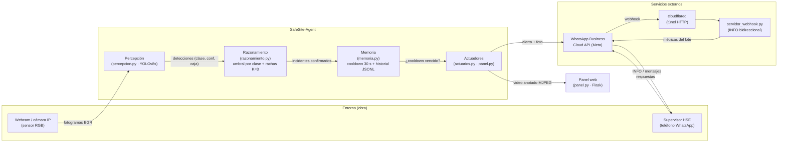
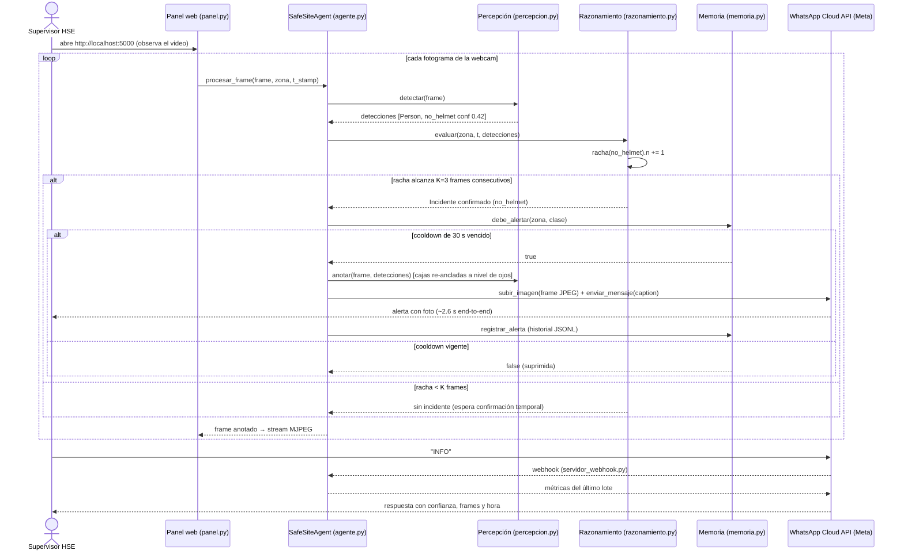

# Sección 9 — Desarrollo del agente (borrador para insertar en el documento de la entrega)

> **Nota de integración:** este archivo es el borrador de la sección "Desarrollo del agente" que pide el enunciado (se inserta antes de Conclusiones, que pasa a ser sección 10). Los números de la subsección 7 (Pruebas) se toman de la suite `src/safesite/pruebas_medidas.py` — ejecutar y actualizar la tabla antes de exportar el PDF.

## 9.1 Arquitectura

El agente sigue el ciclo **percepción → decisión → acción** identificable en el código: `SafeSiteAgent.procesar_frame()` (`src/safesite/agente.py`) ejecuta los tres pasos en orden sobre cada fotograma.

**Mapeo de los siete componentes IBM (sección 8 del diseño) al código:**

| Componente IBM | Módulo que lo implementa | Estado |
|---|---|---|
| Percepción y manejo de entradas | `percepcion.py` — clase `Percepcion` (inferencia YOLOv8s, umbrales) y fuentes (`FuenteCarpeta`, webcam en `panel.py`) | ✅ Implementado |
| Planificación y descomposición de tareas | Pipeline fijo por frame en `agente.py` §1-2-3: detectar → filtrar por clase → confirmar racha → actuar (lote consolidado) | ✅ Implementado (como pipeline determinista, sin búsqueda; coherente con un agente reactivo basado en modelos) |
| Memoria | `memoria.py` — cooldown por (zona, clase) + `historial_incidentes.jsonl` persistente; `razonamiento.py` mantiene el estado de rachas (memoria de corto plazo) | ✅ Implementado |
| Razonamiento y toma de decisiones | `razonamiento.py` — reglas: umbral de confianza **por clase** (0.35 positivas / 0.15 `no_*`) + confirmación temporal K=3 frames consecutivos | ✅ Implementado |
| Llamada de herramientas y acción (tool calling) | `actuarios.py` — `ActuadorWhatsApp` (API Cloud v21.0: subida de imagen + mensaje con caption, degradación a texto); `panel.py` worker asíncrono | ✅ Implementado |
| Comunicación | Mensajes naturales consolidados (un mensaje por frame con todas las faltas + una foto); respuesta automática a **INFO** con métricas del lote vía `servidor_webhook.py` | ✅ Implementado |
| Aprendizaje y adaptación | Reentrenamiento comparado del detector (yolov8n→yolov8s, E19–E23) y re-anclaje documentado de etiquetas (E30); el human-in-the-loop continuo queda como trabajo futuro | ⚠️ Parcial (documentado en §9.8) |

## 9.2 Tecnologías

| Tecnología | Versión | Para qué se usa | Por qué frente a la alternativa |
|---|---|---|---|
| Python | 3.14.6 | Lenguaje del agente | Ecosistema de visión yserve integrado con Ultralytics; alternativa (Node) sin equivalente maduro en detección |
| PyTorch | 2.14.1+cu130 | Backend de la red YOLO; entrenamiento e inferencia en GPU (RTX 4050) | Requisito de Ultralytics; alternativa TensorFlow Object Detection API más costosa de entrenar y desplegar |
| Ultralytics YOLOv8 | 8.4.176 | Detección en tiempo real de 11 clases (persona + EPP + `no_*`) con un solo pase | Detección en un solo paso (~31.5 ms/frame GPU) frente a dos etapas (Faster R-CNN) demasiado lentas para alerta < 10 s; incluye augmentation y métricas |
| OpenCV | 5.0.0.93 | Captura de webcam, anotación de frames (cajas + re-anclaje a nivel de ojos), codificación JPEG | Estándar de facto; alternativa PIL más lenta en video |
| Flask | 3.1.3 | Panel web (video MJPEG + tarjetas + log de incidentes) y endpoints `/estado` | Más simple que FastAPI/Django para un panel de una página; MJPEG no requiere WebSocket |
| Gradio | 6.30.0 | Interfaz web de la **demo pública** (webcam del navegador, subida de imágenes, foto aleatoria del set de test, suite de pruebas con progreso en vivo, pestaña del EDA) | Hecho para demos de ML: trae de fábrica webcam/subida de archivos, cola de trabajos largos con actualizaciones progresivas, tablas y descargas, sin escribir una línea de JS; alternativa Flask+HTML exigiría construir a mano el streaming, la cola y el upload (por eso el panel local sí usa Flask, donde el MJPEG es su fuerte, y la demo pública usa Gradio) |
| Hugging Face Spaces | CPU básico (2 vCPU / 16 GB) | Alojamiento gratuito de la demo con URL pública, HTTPS y despliegue por git | El HTTPS es requisito para que el navegador entregue la webcam; alternativas gratuitas insuficientes (Streamlit Cloud: 1 GB de RAM; Render: 512 MB y se duerme a los 15 min) o inestables para calificar (un túnel local muere al apagar el equipo) |
| requests | 2.34.2 | Cliente HTTP de WhatsApp Cloud API (subida de media + mensajes) | Sincrónico suficiente (el worker va en su propio hilo); alternativa httpx añade complejidad innecesaria |
| WhatsApp Business Cloud API (Meta) | v21.0 | Actuador real de alertas (texto + imagen) y canal conversacional (webhook INFO) | Gratuita en modo prueba con número verificado; alternativa Twilio WhatsApp con costo por mensaje |
| cloudflared | binario externo | Túnel HTTPS público para que Meta entregue los webhooks del INFO en localhost | Sin costo y sin IP pública; alternativa ngrok con límites de sesión más restrictivos |
| Numpy | 2.5.4 | Manipulación de frames y métricas | Estándar |

**Qué razonamiento hace nuestro código y qué hacen las herramientas externas:** todo el razonamiento del agente (umbrales por clase, confirmación temporal K=3, cooldown, consolidación de lotes, degradación ante fallas, re-anclaje visual) está **implementado por nosotros** en `src/safesite/`. Ultralytics ejecuta **solo la percepción** (inferencia de la red entrenada por nosotros); Meta/WhatsApp es **solo el canal de entrega**; no se usa ningún LLM en el ciclo de decisión.

## 9.3 Entradas (inputs)

| Percepción / entrada | Tipo de dato | Rango o formato | Origen | Ejemplo real |
|---|---|---|---|---|
| Fotograma de video | arreglo numpy BGR | 480×640 a 1280×720, 3 canales, uint8 | Webcam USB (panel) / carpeta de imágenes (simulación) / archivo de video | frame 1280×720 de la webcam en la sesión E28 |
| Detección de objeto | 4-tupla + metadatos | `cls_id` (0–10), `conf` (0–1), `caja [x1,y1,x2,y2]` en píxeles | Salida de YOLOv8s (`percepcion.py::detectar`) | `no_helmet, conf=0.42, [312, 89, 398, 171]` |
| Zona / cámara | string | identificador de zona | Argumento de arranque (`--zona`) | `obra_cam1` |
| Marca de tiempo | float | segundos UNIX | Reloj del sistema al capturar el frame | `1792812345.678` |
| Mensaje entrante del supervisor | texto (webhook) | "INFO" o texto libre | WhatsApp Cloud API → webhook (`servidor_webhook.py`) | `INFO` → responde métricas del lote |
| Credenciales del canal | variables de entorno | token, phone_id, destinatario, app_id… | Archivo `.env` (gitignored) | `WHATSAPP_PHONE_ID=123456789` |
| Frame de estado (falla del sensor) | inválido / None / 1 canal | `None`, `ndim<3`, `size==0` | Webcam caída, archivo corrupto, formato inesperado | frame `None` en el escenario S10 de la suite |

## 9.4 Salidas y acciones

| Acción | Efecto en el entorno | Módulo |
|---|---|---|
| Alerta consolidada por WhatsApp (texto + foto del frame anotado) | El supervisor HSE recibe en su teléfono un mensaje natural con todas las faltas del frame, la zona, la hora y la evidencia visual | `actuarios.py::ActuadorWhatsApp.alertar_lote` |
| Degradación a texto puro | Si la subida de la imagen falla, la alerta **nunca se pierde**: se envía texto sin foto | `actuarios.py` (fallback) |
| Respuesta conversacional INFO | El supervisor consulta las métricas técnicas del último lote (confianza, frames confirmados, hora) desde el chat | `servidor_webhook.py` |
| Panel web en vivo | Video MJPEG anotado (cajas re-ancladas a nivel de ojos, etiquetas en español), tarjetas de conteo por clase, log de incidentes y FPS/latencia en `http://localhost:5000` | `panel.py` |
| Persistencia del frame anotado | Evidencia visual en disco por incidente confirmado (`runs/agente/alertas/*.jpg`) | `actuarios.py::ActuadorConsola` |
| Registro del historial | Cada incidente confirmado queda en `runs/agente/historial_incidentes.jsonl` (zona, clase, conf, hora, frames) — memoria de largo plazo del agente | `memoria.py` |
| Supresión de alertas duplicadas | El cooldown de 30 s por (zona, clase) evita bombardear al supervisor ante un incumplimiento persistente | `memoria.py::debe_alertar` |
| Límites anti-spam globales del canal | Mínimo 60 s entre cualquier par de mensajes de WhatsApp y tope de 20 mensajes/hora; las alertas suprimidas quedan en el log con el motivo | `actuarios.py::ActuadorWhatsApp._permite_envio` |
| Pausa de notificaciones | Botón "⏸️ Pausar WhatsApp" del panel: los incidentes se confirman y registran, pero no llegan al teléfono hasta reanudar | `panel.py::toggle_whatsapp` (`POST /whatsapp/toggle`) |
| Envío manual del estado | Botón "📨 Enviar alerta ahora": envía bajo petición explícita el estado actual de la zona (faltas del último frame + foto, o mensaje de "sin novedades"); no está sujeto a pausa ni a límites | `panel.py::enviar_alerta_manual` (`POST /alerta/manual`) |

## 9.5 Diagrama de secuencia UML

**Escenario típico:** un trabajador aparece sin casco; el agente confirma en 3 frames y alerta por WhatsApp.
**Escenario de excepción (fragmento `alt`):** la subida de la foto falla → degradación a texto.

*(El escenario de excepción de actuador —API caída— se prueba en el escenario S12 de la suite: la alerta nunca se pierde, queda en el historial.)*

## 9.6 Diferencias entre diseño e implementación

Tabla completa en `Documentation/TABLA_CAMBIOS.md` (se incluye al inicio del documento ajustado). Resumen: reformulación de la medida de exactitud→recall de incidente (con justificación y umbral pre-registrado), cámaras IP→webcam, priorización por utilidad→cooldown anti-spam, WhatsApp unidireccional→bidireccional con INFO, decisiones solo por clases `no_*` explícitas (hallazgo F6 del EDA), límites anti-spam del canal con pausa y envío manual desde el panel, y **dos perfiles de umbral** (evaluación 0.15 global con el que se validó la suite; vivo, por clase, calibrado en el piloto real para evitar falsas alarmas del dominio webcam — E33).

## 9.7 Pruebas

Suite formal: `src/safesite/pruebas_medidas.py` — medidas M1–M4 con fórmula y **umbral fijado antes de ejecutar**, 13 escenarios (4 normales, 5 límite, 4 de falla esperada) + splits completos val/test, 5 repeticiones por escenario con media y desviación, y log de ejecución con marca de tiempo por frame.

**Ejecución de referencia:** corrida `20261014_170459` (GPU, seed 42, K=3, cooldown 30 s).

| Medida de desempeño | Fórmula | Umbral | Casos ejecutados | Resultado obtenido | ¿Cumple? | Evidencia |
|---|---|---|---|---|---|---|
| M1 Recall de incidente (val) | escenas con alerta / escenas incidente | ≥ 0.7 | 28 escenas × 5 reps | 0.964 ± 0.0 | ✅ | `log_ejecucion.jsonl`, `resultados_*.csv` |
| M1 Recall de incidente (test) | escenas con alerta / escenas incidente | ≥ 0.7 | 26 escenas × 5 reps | 0.962 ± 0.0 | ✅ | `log_ejecucion.jsonl`, `resultados_*.csv` |
| M2 Falsas alarmas (val) | escenas control con alerta / escenas control | ≤ 0.1 | 115 escenas × 5 reps | 0.035 ± 0.0 | ✅ | `log_ejecucion.jsonl` |
| M2 Falsas alarmas (test) | escenas control con alerta / escenas control | ≤ 0.1 | 114 escenas × 5 reps | 0.026 ± 0.0 | ✅ | `log_ejecucion.jsonl` |
| M3 Tiempo de notificación | t(confirmación) − t(inicio racha) + K×latencia + envío WhatsApp | < 10 s | 5 escenarios con alerta × 5 reps | 2.99 s (en vivo E28: ~2.6 s) | ✅ | `resultados_*.csv`; E24/E28 |
| M4 Cooldown anti-spam | duplicadas dentro de la ventana / reincidentes | = 0 | S6 + S7 × 5 reps | S6=1 alerta, S7=2 alertas | ✅ | `log_ejecucion.jsonl` (S6/S7) |

**Detalle por escenario:**

| ID | Tipo | Descripción | Alertas (media±σ) | Excepciones |
|---|---|---|---|---|
| S1 | normal | Trabajador con EPP visible: sin alertas | 0 ± 0 | 0 |
| S2 | normal | Trabajador sin casco: alerta | 1 ± 0 | 0 |
| S3 | normal | Escena con varias faltas: alerta por cada clase `no_*` confirmada | 3 ± 0 | 0 |
| S4 | límite | Incumplimientos múltiples: lote consolidado | 1 ± 0 | 0 |
| S5 | límite | Persona lejana/pequeña | **0 ± 0 (sin alerta)** | 0 |
| S6 | límite | Reincidencia dentro del cooldown: 1 sola alerta | 1 ± 0 | 0 |
| S7 | límite | Reincidencia tras el cooldown: 2 alertas | 2 ± 0 | 0 |
| S8 | normal | Escena sin personas: sin alertas | 0 ± 0 | 0 |
| S9 | límite | Frame negro: sin alertas ni error | 0 ± 0 | 0 |
| S10 | falla | Sensor sin dato (frame None): registrado, sin crash | 0 ± 0 | 0 |
| S11 | falla | Entrada inválida (1 canal): sin crash | 0 ± 0 | 0 |
| S12 | falla | WhatsApp API caída: alerta persistida en historial | 1 ± 0 | 0 |
| S13 | falla | Checkpoint inexistente: arranque con fallo controlado | — | 0 |

El análisis completo (una página: causas del caso límite S5 y propuestas de corrección) está en `Documentation/ANALISIS_PRUEBAS.md`. Logs referenciados en `runs/agente/pruebas/` y **copia versionada para el repositorio** en `eda/salidas/pruebas_fase3/` (CSV + JSON + tabla MD + log JSONL de la corrida de referencia — `runs/` está en `.gitignore`).

## 9.8 Limitaciones y trabajo futuro

1. **Clases débiles por el dataset:** `no_boots` (soporte mínimo: 2 escenas en val) y `no_goggle` (AP50 val 0.10) siguen siendo las clases más débiles; el re-anclaje visual (E30) corrige la presentación pero no el fondo del problema: las etiquetas del dataset fuente son sesgadas y en parte ambiguas (gafas en ojos vs. gafas colgadas al cuello).
2. **Simulación vs. obra real:** la métrica de incidente se mide con simulación de video (4 frames por escena a 2 FPS); en video continuo el recall tiende a ser mayor (más oportunidades temporales), pero no sustituye un piloto de 3 meses.
3. **Calibración del umbral `no_*` (0.15):** en la sesión en vivo (E28) las confianzas correctas rondaron 18–27 %, cerca del umbral; calibrarlo con más horas de piloto real reduciría falsas alarmas (pendiente P10).
4. **Human-in-the-loop:** canal para que el supervisor marque falsos positivos/negativos y alimente un dataset de reentrenamiento (pendiente P11).
5. **Infraestructura de producción:** el túnel cloudflared *quick* cambia de URL en cada arranque; un *named tunnel* con dominio propio es necesario para operar más allá de la demo (pendiente P12).
6. **Privacidad y marco legal:** la captura de imágenes de trabajadores exige consentimiento informado (Ley 1581 de 2012); el piloto real debe incluir esa política antes de desplegarse.
7. **Supuesto de dominio (hallazgos E41/E42):** el EDA validó supuestos de etiquetas, splits, balance y anclaje, pero quedó fuera el supuesto de que toda imagen viene de una obra (así está declarado en su sección de limitaciones). En la práctica falló: en una foto de un partido de fútbol el detector marcó botas sobre los tenis y una caja de gafas por encima de los ojos; un barrido de las 1,413 imágenes encontró 9 casos de cajas de botas duplicadas (pares solapados 30–49% que el NMS deja pasar) y 2 de gafas re-ancladas por encima del 5% de la altura de la persona. La corrección E42 es **solo de presentación**: al dibujar se deduplican cajas solapadas de una misma clase (conserva la de mayor confianza) y el piso del re-anclaje de gafas subió del 3% al 6%; la suite se re-corrrió con resultados idénticos (las decisiones usan las detecciones sin deduplicar). Conclusión para trabajo futuro: el agente es para obras; otros dominios exigen datos de esos dominios (conexión con el banco en vivo E36).

## 9.9 Enlaces

- **Repositorio:** `https://github.com/WilliamLzn/SAFESITE-AGENT`
- **Demo pública (estática, permanente):** `deploy/estatica/` servida por **GitHub Pages** (rama `gh-pages`): `https://williamlzn.github.io/SAFESITE-AGENT/` — el modelo exportado a ONNX corre en el navegador del visitante; equivalencia verificada (diferencias ≤0.018 en test). La página incluye la «Nota del deploy» que explica esta versión frente a la original.
- **Demo completa (Gradio + PyTorch, servidor):** `deploy/app.py` — versión con la suite corriendo en vivo, para sesión local con GPU o Codespaces.
- **Logs de las pruebas:** `runs/agente/pruebas/` (JSONL + CSV + JSON + tabla Markdown)
