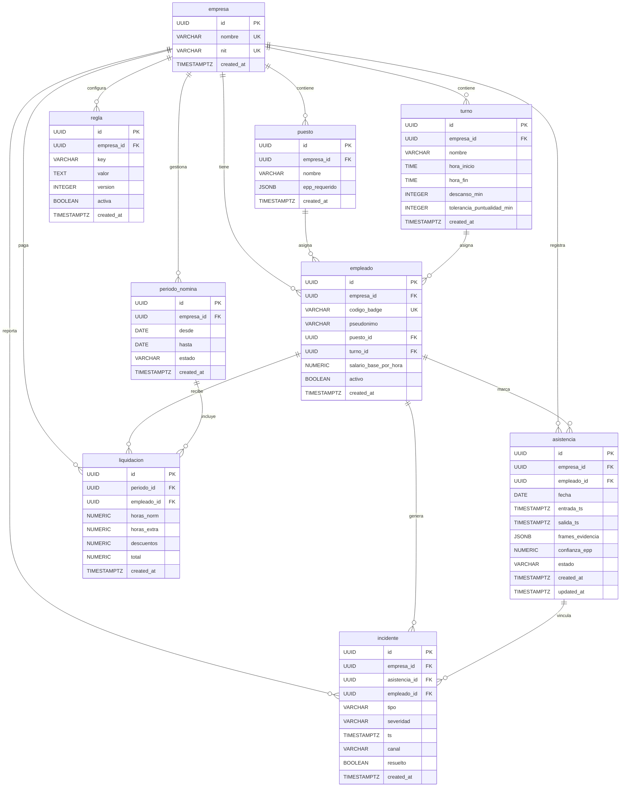
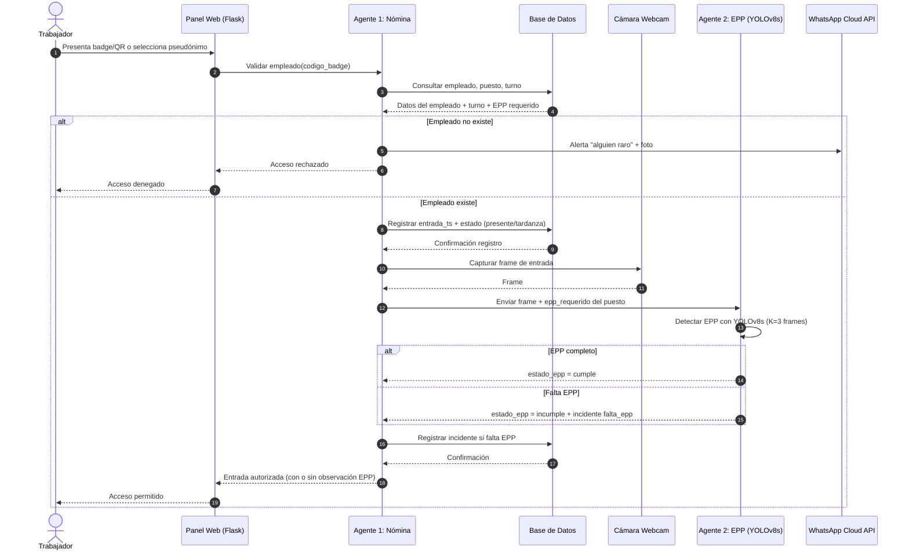
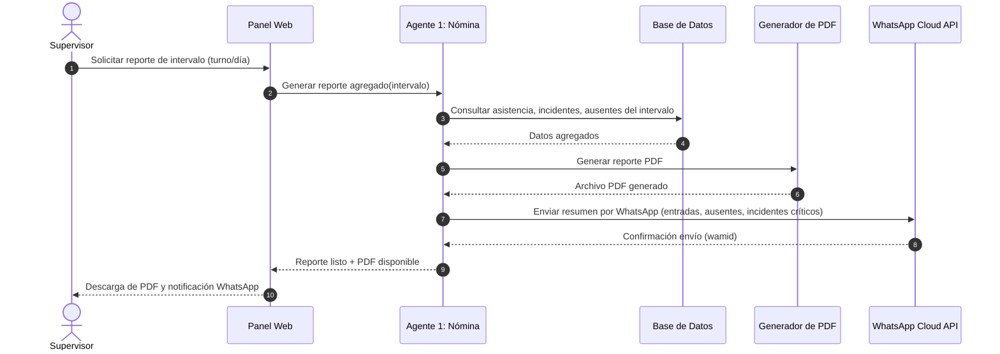

# Diagramas de base de datos y arquitectura — Gestor de Nómina LIVE (SAFESITE-AGENT)

**Proyecto:** SAFESITE-AGENT  
**Metodología:** CRISP-ML(Q) — Fases 3 y 4  
**Versión:** 1.0  
**Fecha:** 02-nov-2026  
**Idioma:** español

---

## 1. Diagrama Entidad-Relación (ER) de la base de datos



---

## 2. Flujo de los dos agentes (secuencial)

```mermaid
flowchart TD
    A[📷 Trabajador llega a la entrada] --> B{Agente 1: Nómina / Identificación}
    B --> C[Validar código badge / QR o selección manual]
    C --> D{¿Está registrado en nómina?}
    D -->|No| E[❌ Rechazar acceso + alerta WhatsApp "alguien raro"]
    D -->|Sí| F[Registrar entrada_ts + verificar puntualidad]
    F --> G[Agente 2: Verificación de EPP]
    G --> H[📷 Analizar frame con YOLOv8s K=3 frames]
    H --> I{¿Lleva EPP completo?}
    I -->|Sí| J[✅ Registrar asistencia como presente/tardanza]
    I -->|No| K[⚠️ Registrar incidente falta_epp, entrada con observación]
    J --> L[Jornada laboral]
    K --> L
    L --> M[🏁 Salida del trabajador]
    M --> N[Registrar salida_ts + calcular horas trabajadas]
    N --> O{Cierre de intervalo o fin de jornada}
    O --> P[📄 Generar reporte PDF agregado]
    O --> Q[📱 Enviar WhatsApp con resumen y alertas]
    P --> R[Fin]
    Q --> R
    E --> R

    style B fill:#e1f5e1,stroke:#333
    style G fill:#e1f5e1,stroke:#333
    style E fill:#ffebee,stroke:#333
    style K fill:#fff3e0,stroke:#333
```

---

## 3. Diagrama de secuencia — Entrada típica (Agente 1 → Agente 2)



---

## 4. Diagrama de secuencia — Cierre de jornada / reporte agregado



---

## 5. Consideraciones de implementación

| Aspecto | Decisión | Justificación |
|---|---|---|
| Base de datos | PostgreSQL con RLS | Multi-tenant, integridad referencial, JSONB para `epp_requerido` y `frames_evidencia` |
| Identificación | Badge/QR o selección manual | Sin reconocimiento facial, cumple restricción de datos personales del curso |
| EPP | No bloquea entrada | Genera incidente/observación; la entrada ya fue validada por Agente 1 |
| Reportes | PDF + WhatsApp | PDF para archivo/evidencia, WhatsApp para notificación inmediata |
| Semilla | 42 | Reproducibilidad de datos sintéticos para pruebas |

---

## 6. Archivos relacionados

| Archivo | Contenido |
|---|---|
| `Documentation/DICCIONARIO_DATOS_NOMINA.md` | Diccionario de datos detallado (atributos, tipos, restricciones) |
| `src/safesite/modelo_datos.sql` | Esquema SQL ejecutable (PostgreSQL) |
| `Documentation/CRISPML_INTEGRACION_NOMINA.md` | Plan de integración completo bajo CRISP-ML(Q) |
| `src/safesite/agente.py` | Lógica del agente existente (percepción → decisión → acción) |
| `src/safesite/razonamiento.py` | Reglas deterministas existentes (umbrales, cooldown, K=3) |

---

> **Nota:** Los diagramas usan Mermaid y pueden renderizarse en GitHub, VS Code u otros visores compatibles. El esquema SQL en `src/safesite/modelo_datos.sql` es la fuente de verdad para la creación de tablas.
