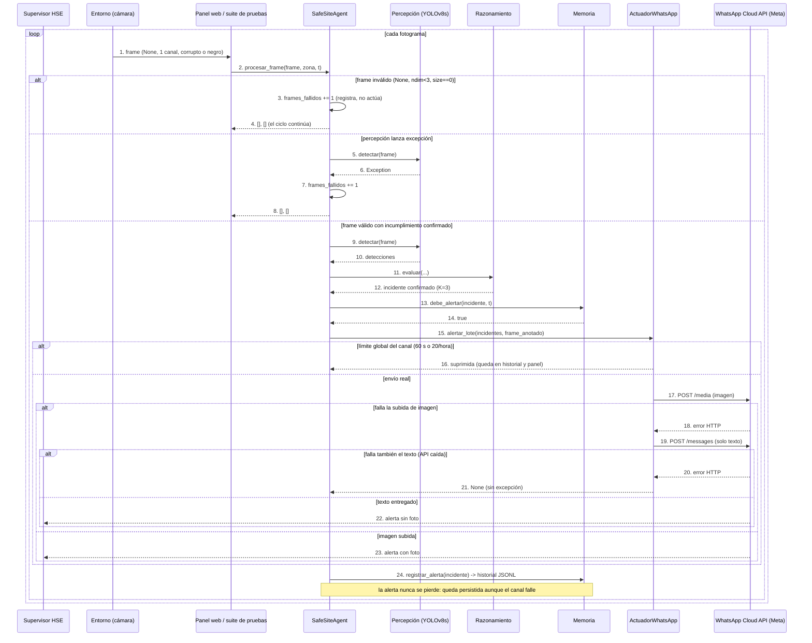

# Diagrama de secuencia: fallas del sensor y degradación del canal de alertas

Comportamiento del agente ante entradas inválidas de la cámara (frame nulo, de un solo canal o corrupto) y ante fallas del canal de WhatsApp (imagen que no sube, API caída, límites anti-spam globales). El sistema nunca se detiene por una falla: registra lo ocurrido, degrada la alerta (con foto, solo texto, o solo en el historial) y continúa su ciclo.

