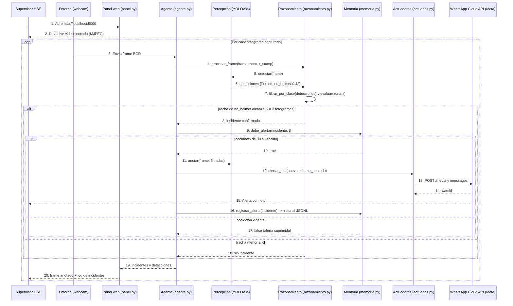

# Diagrama de secuencia: operación normal del agente en vivo

Flujo completo de una sesión de monitoreo con el panel web: el supervisor abre el panel, el agente percibe cada fotograma de la cámara, confirma una falta de casco tras verla en tres fotogramas seguidos (K=3), consulta la memoria de cooldown y envía la alerta consolidada con foto por WhatsApp.

