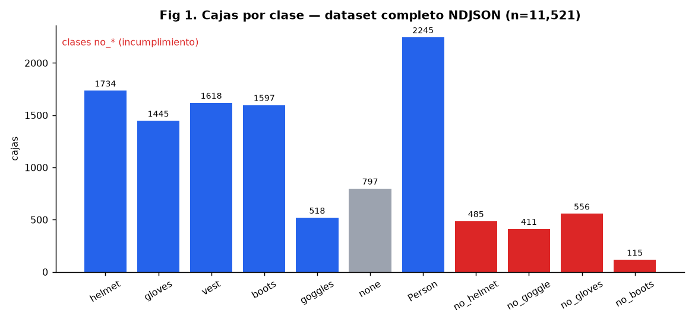
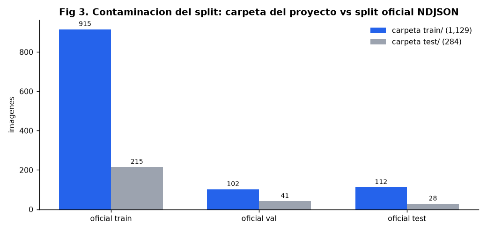
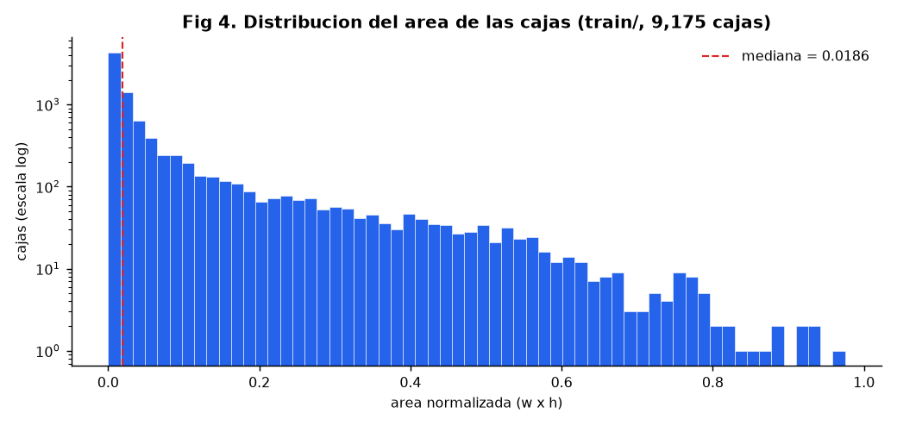
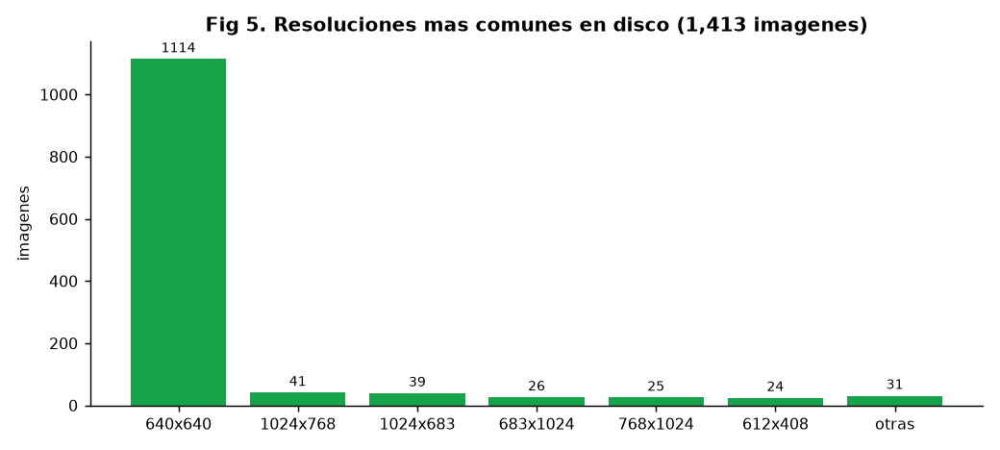

<p align="center">
  
  
  
  
  
</p>

<h1 align="center">👷 SAFESITE-AGENT</h1>

<p align="center">
  <strong>Agente inteligente de monitoreo de seguridad en obra</strong><br/>
  Detección de EPP en tiempo real · razonamiento temporal · alertas automáticas por WhatsApp
</p>

<p align="center">
  <em>Proyecto de Inteligencia Artificial — Universidad Tecnológica de Bolívar</em>
</p>

<p align="center">
  <a href="#-resultados-medidos">📈 Resultados</a> •
  <a href="#-quick-start">🚀 Quick Start</a> •
  <a href="#-arquitectura-del-agente">⚙️ Arquitectura</a> •
  <a href="#-dataset-construction-ppe">📊 Dataset</a> •
  <a href="#-documentación">📚 Docs</a>
</p>

---

## 🤖 ¿Qué es SafeSite-Agent?

**SafeSite-Agent** es un agente que **percibe continuamente** el video de una obra de construcción (cámaras IP/CCTV o webcam), **razona** sobre lo observado con confirmación temporal y memoria anti-spam, y **actúa de forma autónoma** enviando alertas en tiempo real al supervisor HSE por **WhatsApp Business** cuando detecta a un trabajador sin su equipo de protección personal (casco, guantes, chaleco, gafas o botas).

Desde la teoría de agentes, se clasifica como un **model-based reflex agent** (reactivo basado en modelos) con componente de **utilidad** para priorizar alertas: su decisión no depende solo del fotograma actual, sino de un estado interno (rachas por zona/clase + cooldown) que distingue un evento aislado de un patrón recurrente.

> ✅ **Estado del proyecto:** el roadmap completo (Fases 0–4) está **implementado y validado** — incluyendo alertas reales de WhatsApp bidireccionales y un panel web con detección en vivo por webcam. La métrica de negocio pre-registrada (recall de incidente ≥ 0.70) se cumple con holgura: **96.3 % en validación**.

---

## 📈 Resultados medidos

Checkpoint de despliegue: **`runs/safesite/tuned_v2_s/weights/best.pt`** (YOLOv8s, elegido por comparación de experimentos — ver `Documentation/BITACORA.md`).

**Recuperación de incumplimientos a nivel de incidente/escena** (simulación de video, K=3 frames de confirmación):

| Clase de riesgo | Recall val | Recall test |
|---|---:|---:|
| `no_helmet` (sin casco) | **96.3 %** | **83.3 %** |
| `no_goggle` (sin gafas) | 44.0 % | 54.2 % |
| `no_gloves` (sin guantes) | 78.3 % | 65.2 % |
| `no_boots` (sin botas)¹ | 0.0 % | 33.3 % |
| **Cualquier `no_*` en escena** | **96.4 %** | **96.2 %** |
| **Falsas alarmas (escenas control)** | 3.5 % | 2.6 % |

¹ Soporte muy bajo en val/test (2 y 6 escenas) → métrica poco fiable, ver EDA.

**Rendimiento del pipeline:** ~31.5 ms/frame en GPU (RTX 4050) → sobrado para el objetivo de alerta < 10 s. Baseline original (YOLOv8n): mAP50 val 0.580 / test 0.520.

---

## 🚧 El problema que resuelve

El incumplimiento en el uso de EPP es una de las principales causas de accidentalidad en construcción. La supervisión manual tiene un límite claro: *un supervisor no puede observar de forma simultánea y continua todos los puntos críticos de una obra*.

| Limitación de la supervisión humana | Cómo lo aborda SafeSite-Agent |
|---|---|
| Monitoreo discontinuo y limitado | Observación continua del flujo de video |
| Tiempo de reacción variable | Alertas automáticas por WhatsApp en segundos |
| Criterio subjetivo / fatiga | Criterio estandarizado (confirmación temporal K=3) |
| Difícil atender eventos simultáneos | Memoria por zona/horario, sin notificaciones duplicadas |

**Entorno de operación:** obra de construcción (área piloto). Ambiente *parcialmente observable, estocástico, secuencial, dinámico y continuo*, gestionado por un **agente único**.

---

## ⚙️ Arquitectura del agente

```
                ┌─────────────────────────────────────────────────────┐
                │            ENTORNO (obra de construcción)           │
                │   webcam / cámaras IP ▪ trabajadores ▪ iluminación  │
                └─────────────────────────────────────────────────────┘
                                       │  frames RGB
                                       ▼
┌──────────────────────────────────────────────────────────────────────────────────┐
│ PERCEPCIÓN                      src/safesite/percepcion.py                       │
│  ▪ YOLOv8s (tuned_v2_s/best.pt) ▪ umbrales por clase (no_* = 0.15, resto 0.35)   │
│  ▪ decisión basada SOLO en clases no_* explícitas (evita el fallo 38.2% del      │
│    anidamiento casco/persona — hallazgo F6 del EDA)                              │
└──────────────────────────────────────────────────────────────────────────────────┘
                                       │  detecciones + metadatos
                                       ▼
┌──────────────────────────────────────────────────────────────────────────────────┐
│ RAZONAMIENTO + MEMORIA        src/safesite/razonamiento.py · memoria.py          │
│  ▪ confirmación temporal: K=3 frames consecutivos para confirmar incidente       │
│  ▪ cooldown anti-spam: 30 s mínimo entre alertas del mismo (zona, clase)         │
│  ▪ historial persistente por (zona, clase) en historial_incidentes.jsonl         │
└──────────────────────────────────────────────────────────────────────────────────┘
                                       │  incidentes confirmados
                                       ▼
┌──────────────────────────────────────────────────────────────────────────────────┐
│ ACTUADORES                       src/safesite/actuarios.py                       │
│  ▪ WhatsApp Business: UN mensaje por incidente con TODAS las faltas + 1 foto     │
│    ("Detectamos varios incumplimientos: • Sin Casco • Sin Guantes…")             │
│  ▪ conversación bidireccional: el supervisor responde INFO → métricas técnicas   │
│  ▪ Panel web (Flask + MJPEG): video anotado en vivo, tarjetas EPP, log de eventos│
│  ▪ Consola + frames anotados guardados en runs/agente/alertas/                   │
└──────────────────────────────────────────────────────────────────────────────────┘
```

**Sesión en vivo (2 procesos en paralelo):**

| Proceso | Puerto | Rol |
|---|---|---|
| `piloto.py` | 8000 | Webhook (stdlib) + túnel cloudflared + auto-registro del webhook en Meta |
| `panel.py` | 5000 | Webcam + video MJPEG anotado en http://localhost:5000 + WhatsApp asíncrono |

---

## 📊 Dataset: Construction PPE

Dataset oficial **Construction PPE** (Ultralytics), tarea de detección de objetos.

<p align="center">
  
  
  
</p>

**Split oficial usado para entrenar** (`dataset_v2/`, generado por `eda/06_resplit_oficial.py`, seed 42 — corrige la contaminación train/val/test detectada en el EDA):

| Split  | Imágenes | Etiquetado | Uso |
|--------|---------:|:---:|---|
| Train  | 1,130 | ✅ | Entrenamiento |
| Valid  |   143 | ✅ | Selección de modelo |
| Test   |   140 | ✅ | Evaluación final |

**Las 11 clases** (las `no_*` = incumplimiento, el objetivo del agente):

| ID | Clase | Cajas | ID | Clase | Cajas |
|----|-------|------:|----|-------|------:|
| 0  | helmet    | 1,734 | 6  | Person    | 2,245 |
| 1  | gloves    | 1,445 | 7  | no_helmet |   485 |
| 2  | vest      | 1,618 | 8  | no_goggle |   411 |
| 3  | boots     | 1,597 | 9  | no_gloves |   556 |
| 4  | goggles   |   518 | 10 | no_boots  |   115 |
| 5  | none      |   797 |    |           |       |

<details>
<summary><strong>📉 Ver figuras del EDA</strong> (distribuciones, splits y señales de riesgo)</summary>

<p align="center">
  
  
  
  
</p>

Hallazgos clave del EDA (`Documentation/EDA_SAFESITE_DATASET.md`, hallazgos F1–F10): desbalance severo de `no_*` (solo 20.3 % de train con incumplimiento), etiquetas YOLO íntegras, contaminación del split original corregida en `dataset_v2/`.

</details>

---

## 🗂️ Estructura del repositorio

```
SAFESITE-AGENT/
├── README.md                        # este documento
├── AGENTS.md                        # convenciones para agentes de IA
├── construction-ppe.ndjson          # metadatos oficiales del dataset (solo lectura)
├── image_downloader.py              # pipeline original (OBSOLETO: URLs CDN expiradas)
├── safesite_dataset/                # dato CRUDO (respaldo; no regenerable desde internet)
├── dataset_v2/                      # re-split OFICIAL p/ entrenar (images/ + labels/ + dataset.yaml)
├── eda/                             # EDA reproducible: scripts 01…06, salidas/, figuras/
├── src/
│   ├── entrenamiento/
│   │   └── entrenar_baseline.py     # entrenamiento YOLOv8 (seed 42, workers=0 en Windows)
│   └── safesite/                    # NÚCLEO DEL AGENTE
│       ├── agente.py                # orquestador percibir → razonar → actuar
│       ├── percepcion.py            # wrapper YOLO + umbrales por clase
│       ├── razonamiento.py          # confirmación temporal (K frames)
│       ├── memoria.py               # cooldown anti-spam + historial jsonl
│       ├── actuarios.py             # consola + WhatsApp Business (Cloud API)
│       ├── servidor_webhook.py      # webhook stdlib (perfil/INFO) para Meta
│       ├── piloto.py                # arranque autónomo webhook+túnel cloudflared
│       ├── panel.py                 # panel web Flask+MJPEG con webcam en vivo
│       ├── prueba_whatsapp.py       # prueba de alertas rotativas (¡envía reales!)
│       └── demo.py                  # simulación de video + métricas de incidente
├── runs/                            # experimentos (gitignored; mejor: safesite/tuned_v2_s)
└── Documentation/
    ├── Diseño_Agente_SafeSite.pdf   # documento académico de diseño
    ├── EDA_SAFESITE_DATASET.md      # informe EDA (F1–F10)
    ├── ROADMAP_AGENTE.md            # roadmap Fases 0–5 (0–4 ✅)
    ├── BITACORA.md                  # registro de TODAS las ejecuciones (E1–E29)
    ├── WHATSAPP_LIMITES_COSTOS.md   # límites, cuotas y costos de la Cloud API
    └── SKILLS.md                    # skills instaladas y procedencia
```

---

## 🚀 Quick Start

Requisitos: **Python 3.11+** con el entorno `.venv` (torch + ultralytics). Credenciales de WhatsApp en `.env` (no versionado).

```powershell
# Demo del agente sobre el dataset (simulación de video, métricas de incidente)
.venv\Scripts\python.exe -m src.safesite.demo

# Panel web EN VIVO por webcam → http://localhost:5000
.venv\Scripts\python.exe -m src.safesite.panel --device 0

# Piloto WhatsApp (webhook + túnel + auto-registro en Meta)
.venv\Scripts\python.exe -m src.safesite.piloto

# Entrenar un nuevo run (nombre obligatorio, no sobrescribe)
.venv\Scripts\python.exe src\entrenamiento\entrenar_baseline.py --name mi_run
```

> 🎥 **Sesión en vivo completa:** `piloto.py` (puerto 8000) y `panel.py` (puerto 5000) en paralelo → alertas con foto por WhatsApp + respuesta **INFO** conversacional mientras el video sigue fluyendo.

---

## 🗓️ Roadmap

| Fase | Objetivo | Estado |
|---|---|---|
| 0 | Corregir datos (re-split oficial `dataset_v2`) | ✅ |
| 1 | Baseline YOLO entrenado (`baseline_v1`) | ✅ |
| 2 | Tuning anti-desbalance → gana **YOLOv8s** (`tuned_v2_s`) | ✅ |
| 3 | Núcleo del agente (percepción → razonamiento → memoria) | ✅ |
| 4 | Actuadores: WhatsApp bidireccional + panel web en vivo | ✅ |
| 5 | Mejora continua (calibrar umbral, human-in-the-loop, dominio fijo) | 🔄 |

Detalle completo: `Documentation/ROADMAP_AGENTE.md` · historial de ejecuciones: `Documentation/BITACORA.md` (E1–E29).

---

## 📚 Documentación

| Documento | Contenido |
|---|---|
| `Documentation/EDA_SAFESITE_DATASET.md` | EDA completo: integridad, desbalance, contaminación de splits |
| `Documentation/ROADMAP_AGENTE.md` | Plan de ejecución del agente y criterios pre-registrados |
| `Documentation/BITACORA.md` | Registro bitácora de experimentos y ejecuciones (fecha, comando, seed, resultados) |
| `Documentation/WHATSAPP_LIMITES_COSTOS.md` | Límites/costos de WhatsApp Business Cloud API (prueba vs producción) |
| `Documentation/Diseño_Agente_SafeSite.pdf` | Documento académico de diseño del agente |

---

## 🎓 Créditos

**SAFESITE-AGENT** es un proyecto académico de la asignatura **Inteligencia Artificial**:

| | |
|---|---|
| **Universidad** | Universidad Tecnológica de Bolívar |
| **Programa** | Ingeniería en Sistemas y Computación |
| **Presentado por** | William David Lozano Julio — T00078475 |
| **Curso** | Inteligencia Artificial |
| **Docente** | Edwin Alexander Puertas Del Castillo |
| **Fecha** | 28/08/2026 → última fase completada 13/10/2026 |

**Referencias:**
- Russell, S. J., & Norvig, P. *Artificial Intelligence: A Modern Approach*.
- Ultralytics — *Construction-PPE Dataset* · *YOLOv8*.
- Meta — *WhatsApp Business Cloud API*.
- *PPE detector: a YOLO-based architecture...* (PMC).

---

<sub>
**Nota de transparencia:** la documentación de este repositorio se redactó con ayuda de agentes de inteligencia artificial (OpenCode / modelos de lenguaje), que analizaron el dataset, el código, la bitácora y el documento de diseño. Todo el contenido refleja fielmente los archivos del repositorio y los datos reales medidos en los experimentos, sin elementos inventados.
</sub>
